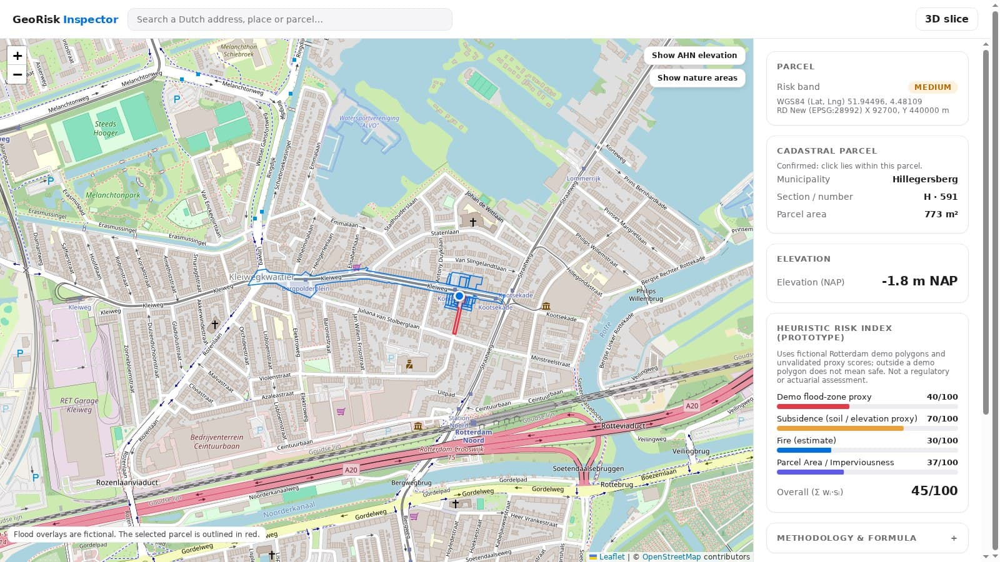

# GeoRisk Inspector

A micro-app for inspecting Dutch parcels: an interactive 2D map with live cadastral
parcel boundaries, a transparent Heuristic Risk Index, an AHN elevation overlay, an
optional 3D parcel slice, and a metrics drawer (AHN elevation and experimental flood /
subsidence / fire / area sub-scores).

Built with Vite + Vue 3 + vue-leaflet (OpenStreetMap tiles, no API keys) +
Chart.js + GSAP + Three.js. Live data comes from **PDOK** (Locatieserver + Kadaster +
AHN + BAG).



> **Netherlands only.** The risk model uses the Dutch RD New projection (EPSG:28992),
> PDOK elevation data, and Dutch soil/flood logic. Search and coordinates are restricted
> to the NL bounding box.

## Run it

Requires **Node.js 22.12 or newer** (enforced by Vitest 5; Vite alone supports 20.19+).

```sh
pnpm install
pnpm run dev      # local dev server
pnpm run build    # production build into dist/
pnpm run preview  # preview the production build
pnpm test         # unit and async-state regression tests
pnpm exec playwright install chromium  # once, for browser tests
pnpm test:e2e     # mocked browser tests; starts Vite locally
```

(`npm` works too; `pnpm-lock.yaml` is the canonical lockfile.)

Playwright downloads its own browser. If using an existing compatible Chromium binary,
set `PLAYWRIGHT_CHROMIUM_EXECUTABLE_PATH` to its absolute path. Browser tests mock external
services by default. To additionally run the opt-in live PDOK CORS smoke test, use
`PDOK_LIVE_SMOKE=1 pnpm test:e2e`; it needs network access and can fail when PDOK is down.
Automated browser coverage currently uses Chromium only; physical devices and screen
readers have not been tested.

Search a Dutch address, place or parcel (via PDOK Locatieserver autocomplete) or paste
`lat,lng`. **Click anywhere on the map** to inspect the cadastral parcel at that point.
The selection is encoded in the URL (`?lat=&lng=&q=`), so any view is shareable and
survives reload. Opening the 3D slice adds `view=3d` to the URL.

## Heuristic Risk Index (Prototype)

`src/lib/riskEngine.js` — no backend, everything runs in the browser:

```
Risk Index = Σ (wᵢ × sᵢ)          with Σ wᵢ = 1.0 and each sᵢ ∈ [0, 100]
```

| Factor | Weight | Sub-score source |
|---|---|---|
| Demo flood-zone proxy | 0.40 | Fictional Rotterdam-area polygon containment and elevation thresholds; **not** a flood map |
| Subsidence | 0.25 | Elevation heuristic, not measured subsidence or a soil map |
| Fire | 0.15 | Constant 30; no fire hazard data |
| Parcel area proxy | 0.20 | PDOK cadastral area or a fixed default; area is not measured imperviousness |

Banded **high (≥66) / medium (≥34) / low**. The drawer's **"Methodology & Formula"** card
shows every factor's raw value, unit, weight, sub-score and data source
(`PDOK Kadaster WFS` vs `Heuristic Proxy`).

> **Prototype Heuristic Index** — combines live PDOK Cadastral geometry with simulated
> hydrological weights. It is **not** an actuarial or regulatory model. It has not
> been calibrated or validated for any location. Demo polygons cover only small
> illustrative areas near Rotterdam; being outside them is not evidence of safety.
> The fixed-value valuation and depreciation chart have been removed: there is no
> defensible valuation or loss model here.

### Elevation
Live PDOK AHN WMS query (`dtm_05m`; WMS 1.1.1 primary, 1.3.0 fallback). Elevation is shown
as **metres relative to NAP (Normaal Amsterdams Peil)**. The nearest returned AHN sample
is used. When elevation is unavailable, no synthetic value is substituted: the two
elevation-dependent scores and the overall index are withheld.

### Coordinates
The drawer shows the click in both **WGS84 (Lat, Lng)** and **RD New (EPSG:28992)** X/Y metres,
projected with the same `proj4` transform used for the AHN query.

## Data sources (all free, keyless, CORS-enabled)

- Base tiles: OpenStreetMap standard
- Geocoding: **PDOK Locatieserver v3.1** (`suggest` for autocomplete, `lookup` for
  `centroide_ll` geometry)
- Cadastral parcels: **PDOK Kadastrale Kaart WFS v5** (`kadastralekaartv5:perceel`,
  CRS84 lon/lat bbox around the click). The clicked parcel is found by exact
   point-in-polygon (Polygon/MultiPolygon), falling back to an explicitly approximate
   nearest parcel centroid within 50 m. Results are paginated up to 250 features;
   if that limit is reached, approximate matches are withheld and the UI warns that
   the results are incomplete.
- Elevation: PDOK AHN WMS (`dtm_05m`) — both GetFeatureInfo (point elevation) and
  `LWmsTileLayer` GetMap overlay (toggle: *Show AHN elevation*)
- Flood overlays: bundled **fictional demo** polygons around Rotterdam
  (`src/data/mockFloodZones.json`); no live flood lookup is implemented.
- Optional **nature areas** overlay: the public IPO/Risicokaart
  [combustible nature areas dataset](https://data.overheid.nl/dataset/13235-natuurbranden),
  loaded on demand as WMS tiles. It covers selected large nature areas (at least 100 ha),
  not all fire hazards, current fire danger or property risk. An unshaded area is not
  necessarily safe; the overlay does not affect the heuristic index. The map warns if
  tiles fail, but cannot verify completeness or currency from a rendered image alone.

Search and coordinate input are debounced with `AbortController` cancellation, so rapid
map clicks can't overwrite fresh data with stale results. WMS/parcel failures degrade
gracefully with an **"Offline / Fallback Mode"** badge instead of throwing.

The optional **3D slice** loads BAG building footprints and AHN DTM/DSM rasters from
PDOK on demand (`bag:pand` via WFS; `dtm_05m` / `dsm_05m` via WCS). Building heights
may be estimated where raster data is missing; large parcels are displayed in a clipped
window. Samples beyond raster coverage are treated as missing, not extrapolated.
Buildings with partially missing AHN samples are marked estimated, and missing terrain
is visually filled with a warning. Three.js is only downloaded when the view is first
opened.

### Before using real hazard data

Replacing the demo requires a documented national flood-hazard dataset with appropriate
scenario, return period, date, licence, coverage and uncertainty; separately validated
subsidence and fire datasets; and a defensible model calibrated for the intended use.
AHN terrain height alone is not flood probability. Until then, the index must not be
used for purchase, insurance, engineering design, or safety decisions.

## Project layout

```
src/
  components/   SearchBar, RiskMap, MetricsDrawer, RiskChart, ParcelSlice3D
  composables/  useParcel (live Kadaster WFS), useParcelMetrics (debounced/abortable),
                useGeocoding (PDOK Locatieserver, NL-scoped), useParcelSlice (3D data),
                useReveal (GSAP)
  lib/          riskEngine (Heuristic Risk Index), rd (RD New projection),
                pdok3d + slice (BAG/AHN 3D data and geometry), gsap setup,
                location defaults
  data/         mockFloodZones.json (fictional demo polygons)
  router/       single route, ?lat=&lng=&q=&view= state
e2e/            Playwright browser tests; playwright.config.js starts Vite
```
