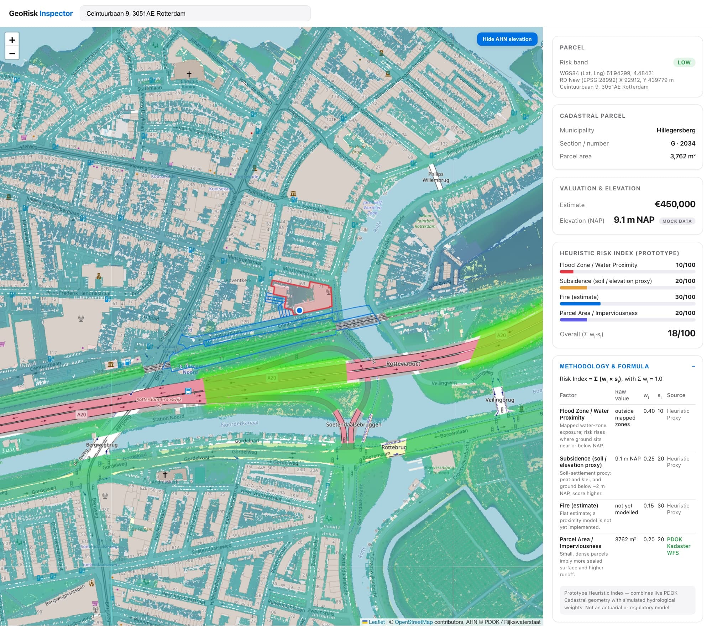

# GeoRisk Inspector

A micro-app for inspecting Dutch parcels: an interactive 2D map with live cadastral
parcel boundaries, a transparent Heuristic Risk Index, an AHN elevation overlay, and a
property metrics drawer (valuation estimate, AHN elevation, flood / subsidence / fire /
area sub-scores, 10-year depreciation).

Built with Vite + Vue 3 + vue-leaflet (OpenStreetMap tiles, no API keys) +
Chart.js + GSAP. Live data comes from **PDOK** (Locatieserver + Kadaster + AHN).



> **Netherlands only.** The risk model uses the Dutch RD New projection (EPSG:28992),
> PDOK elevation data, and Dutch soil/flood logic. Search and coordinates are restricted
> to the NL bounding box.

## Run it

```sh
pnpm install
pnpm run dev      # local dev server
pnpm run build    # production build into dist/
pnpm run preview  # preview the production build
```

(`npm` works too; `pnpm-lock.yaml` is the canonical lockfile.)

Search a Dutch address, place or parcel (via PDOK Locatieserver autocomplete) or paste
`lat,lng`. **Click anywhere on the map** to inspect the cadastral parcel at that point.
The selection is encoded in the URL (`?lat=&lng=&q=`), so any view is shareable and
survives reload.

## Heuristic Risk Index (Prototype)

`src/lib/riskEngine.js` — no backend, everything runs in the browser:

```
Risk Index = Σ (wᵢ × sᵢ)          with Σ wᵢ = 1.0 and each sᵢ ∈ [0, 100]
```

| Factor | Weight | Sub-score source |
|---|---|---|
| Flood Zone / Water Proximity | 0.40 | flood-zone polygon ∩ point + elevation |
| Subsidence (soil / elevation proxy) | 0.25 | Dutch soil type (`veen`/`klei`/`zand`) or elevation heuristic |
| Fire (estimate) | 0.15 | not yet modelled |
| Parcel Area / Imperviousness | 0.20 | `kadastraleGrootteWaarde` (live PDOK) or heuristic |

Banded **high (≥66) / medium (≥34) / low**. The drawer's **"Methodology & Formula"** card
shows every factor's raw value, unit, weight, sub-score and data source
(`PDOK Kadaster WFS` vs `Heuristic Proxy`).

> **Prototype Heuristic Index** — combines live PDOK Cadastral geometry with simulated
> hydrological weights. It is **not** an actuarial or regulatory model.

### Elevation
Live PDOK AHN WMS query (`dtm_05m`; WMS 1.1.1 primary, 1.3.0 fallback). Elevation is shown
as **metres relative to NAP (Normaal Amsterdams Peil)**. On failure a deterministic mock
elevation is used and the drawer shows a **"mock data"** badge; hover it for the data source.

### Coordinates
The drawer shows the click in both **WGS84 (Lat, Lng)** and **RD New (EPSG:28992)** X/Y metres,
projected with the same `proj4` transform used for the AHN query.

## Data sources (all free, keyless, CORS-enabled)

- Base tiles: OpenStreetMap standard
- Geocoding: **PDOK Locatieserver v3.1** (`suggest` for autocomplete, `lookup` for
  `centroide_ll` geometry)
- Cadastral parcels: **PDOK Kadastrale Kaart WFS v5** (`kadastralekaartv5:perceel`,
  CRS84 lon/lat bbox around the click). The clicked parcel is found by exact
  point-in-polygon (Polygon/MultiPolygon), falling back to the nearest parcel centroid
  within 50 m for clicks on a boundary
- Elevation: PDOK AHN WMS (`dtm_05m`) — both GetFeatureInfo (point elevation) and
  `LWmsTileLayer` GetMap overlay (toggle: *Show AHN elevation*)
- Flood overlays: bundled **demo** polygons around Rotterdam
  (`src/data/mockFloodZones.json`) — clearly labelled as demo data, used as the offline
  fallback when a live lookup is unavailable

Search and coordinate input are debounced with `AbortController` cancellation, so rapid
map clicks can't overwrite fresh data with stale results. WMS/parcel failures degrade
gracefully with an **"Offline / Fallback Mode"** badge instead of throwing.

## Project layout

```
src/
  components/   SearchBar, RiskMap, MetricsDrawer, RiskChart
  composables/  useParcel (live Kadaster WFS), useParcelMetrics (debounced/abortable),
                useGeocoding (PDOK Locatieserver, NL-scoped), useReveal (GSAP)
  lib/          riskEngine (Heuristic Risk Index), gsap setup, location defaults
  data/         mockFloodZones.json (demo fallback)
  router/       single route, ?lat=&lng=&q= state
```
