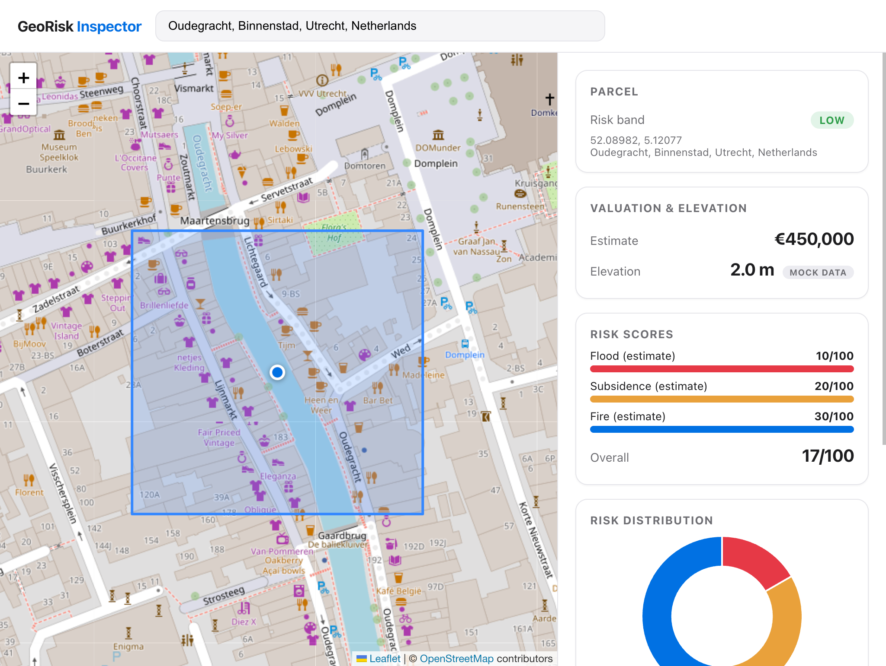

# GeoRisk Inspector

A micro-app for inspecting Dutch parcels: an interactive 2D map with flood-zone
overlays plus a live property metrics drawer (valuation estimate, AHN elevation,
flood / subsidence / fire scores, 10-year depreciation).

Built with Vite + Vue 3 + vue-leaflet (OpenStreetMap tiles, no API keys) +
Chart.js + GSAP.



> **Netherlands only.** The risk model uses the Dutch RD New projection
> (EPSG:28992), PDOK elevation data, and Dutch soil/flood logic. Search and
> coordinates are restricted to the NL bounding box.

## Run it

```sh
pnpm install
pnpm run dev      # local dev server
pnpm run build    # production build into dist/
pnpm run preview  # preview the production build
```

(`npm` works too; `pnpm-lock.yaml` is the canonical lockfile.)

Search a Dutch address (e.g. Rotterdam) or paste
`lat,lng`. The parcel is encoded in the URL (`?lat=&lng=&q=`), so any view is
shareable and survives reload.

## How risk is computed

`src/lib/riskEngine.js` — no backend, everything runs in the browser:

1. **Elevation** — live PDOK AHN WMS query (`dtm_05m` layer; WMS 1.1.1 primary,
   1.3.0 fallback). On failure a deterministic mock elevation is used and the
   drawer shows a **"mock data"** badge; hover it for the data source.
2. **Flood score** — point-in-polygon lookup (Flatbush R-tree + `@turf`)
   against flood-zone polygons, combined with elevation.
3. **Subsidence score** — Dutch soil-type lookup (`veen`/`klei`/`zand`) with an
   elevation heuristic until real Bodemkaart polygons land.
4. **Overall** — `flood×0.5 + subsidence×0.3 + fire×0.2`, banded
   high (≥66) / medium (≥34) / low.

Search (Nominatim, `countrycodes=nl`) and coordinate input are debounced with
`AbortController` cancellation, so rapid map clicks can't overwrite fresh data.

## Data sources (all free, keyless)

- Base tiles: OpenStreetMap standard
- Geocoding: Nominatim (`countrycodes=nl`)
- Elevation: PDOK AHN WMS (`dtm_05m`)
- Flood overlays: bundled mock polygons around Rotterdam
  (`src/data/mockFloodZones.json`) — replace with real dijkring data for
  production accuracy outside Rotterdam.

## Project layout

```
src/
  components/   SearchBar, RiskMap, MetricsDrawer, RiskChart
  composables/  useParcelMetrics (debounced/abortable), useGeocoding (NL-scoped), useReveal (GSAP)
  lib/          riskEngine, gsap setup, location defaults
  data/         mockFloodZones.json
  router/       single route, ?lat=&lng=&q= state
```
